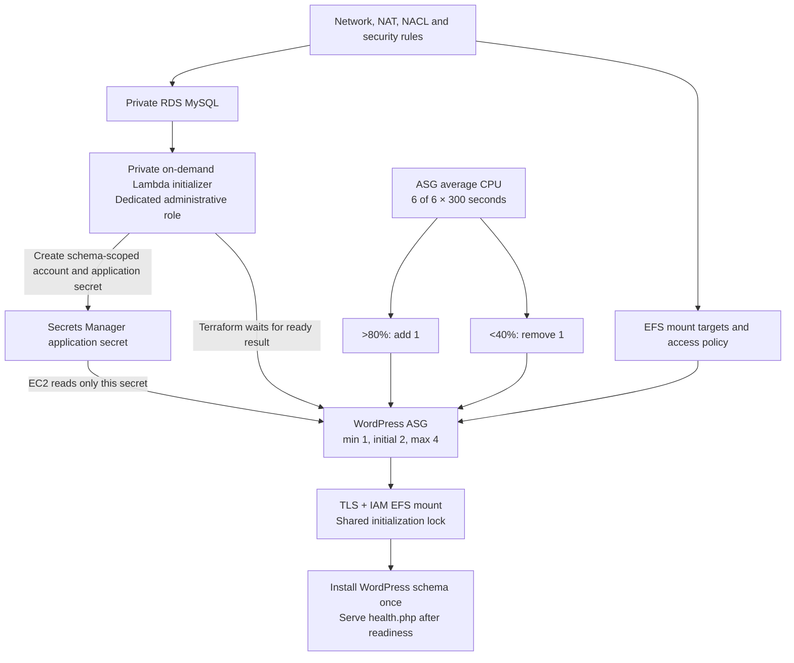

# WordPress compute and initialization

Compute checkpoint: 2026-11-01 (Asia/Bangkok). The historical compute-only plan contained 94 additions. The final integrated configuration includes the frontend and has 108 additions; see the current report and test results. Nothing has been deployed.

## Provisioning sequence



The small Lambda initializer is an additional design choice, not a service named by the test. An on-demand function fits the short administrative task that runs during provisioning and then sits idle. It keeps RDS master access out of the EC2 runtime role. It has no public endpoint or event subscription.

## Database and site initialization

Terraform creates the application secret metadata, a private Lambda function, its separate role, and a synchronous `aws_lambda_invocation` resource. This resource invokes only during a real apply; `plan` does not execute it. Its `CREATE_ONLY` lifecycle prevents invocation during destroy. Changes to its trigger inputs can cause a new initialization run.

The function retrieves the current RDS-managed master secret, connects using a validating TLS context with the AWS RDS CA bundle, and takes a MySQL named lock. Under that lock, it retrieves or generates the application secret and creates/updates the fixed `wordpress` user with `REQUIRE SSL`. Its privileges are `ALL PRIVILEGES ON wordpress.*`, allowing WordPress schema changes while granting no global administration privileges.

The secret contains the database password, eight shared WordPress authentication keys/salts, and initial site administrator credentials. It is written before account SQL so retries reuse the same password after interruption. Both secret generation and SQL are serialized by the database lock to avoid concurrent invocations publishing mismatched passwords. The function returns only `{"ready": true}`. Exceptions are sanitized to avoid leaking SQL/password details into Lambda responses and logs. Terraform's invocation postcondition requires readiness before the dependent compute module can proceed.

WordPress core/schema installation then uses a separate NFS lock on EFS so multiple EC2 instances do not race. Shared content is seeded only once. A database named lock does not replace the shared-content lock: they protect different operations.

## IAM boundaries

| Principal | Allowed access | Explicit limits |
|---|---|---|
| Lambda initializer role | Read the specific master secret; read/write the specific application secret; write its own log streams; manage required VPC ENIs | No EFS permissions, secret listing, public invocation policy or arbitrary-secret access |
| EC2 application role | Read the specific application secret; mount/write the specific EFS filesystem using its access point, TLS and mount targets; minimal SSM registration/channel actions | No RDS master secret, secret writes, SSM Parameter Store reads or EFS root access |

VPC Lambda requires a limited set of EC2 ENI actions on `Resource: "*"`, as documented by AWS. The policy also denies those actions when the request carries this function's `lambda:SourceFunctionArn`, preventing its application code from using the ENI privileges while allowing Lambda's service operations. CloudWatch Logs access is scoped to the initializer's log group with 30-day retention.

The SSM agent channel/registration actions use `Resource: "*"` because usable instance-specific resource scoping is unavailable for those calls. The role intentionally omits association/inventory/patch-management permissions. Validate Session Manager connectivity after deploy; a full fleet-management policy is outside this checkpoint. Session content logging and a durable account CloudTrail trail require separate account configuration and are not enabled here.

The EC2 and Lambda execution trust policies use their service principals. Source ARN/account trust conditions are not added without evidence that the execution-role assumption supplies those keys. The operator still needs permission to pass only the intended roles and invoke the specific initializer.

## Image, packages and bootstrap

The base image is the Amazon-owned AL2023 x86_64 AMI `ami-062900c135ab91582` in `ap-southeast-2`, resolved from `/aws/service/ami-amazon-linux-latest/al2023-ami-kernel-default-x86_64` and then pinned in configuration. Read-only EC2 lookup confirmed it is available, x86_64, and uses `/dev/xvda`. Changing region requires selecting an appropriate AMI. This interprets the test's “WordPress image” as a base AMI bootstrapped into WordPress, rather than a separately pre-baked WordPress AMI.

Each launch uses a numeric launch-template version, IMDSv2 with hop limit 1, an encrypted 20-GiB gp3 root disk, detailed monitoring, a dedicated instance profile, and a private network interface with no public IP or SSH key. `t3.small` is configured with unlimited credits so a new instance can sustain the CPU condition used by the test. Sustained CPU consumption above its credit baseline can incur surplus-credit charges. Detailed monitoring, EC2/EBS, Lambda execution, secret storage and log retention also add charges after a real deployment; no cost estimate is asserted.

User data contains only code and non-secret metadata. It installs a retrying systemd bootstrap service. The service installs Apache, PHP 8.3 extensions and EFS utilities from the AL2023 repository snapshot, downloads WordPress `7.1.4` and the RDS CA, and verifies their SHA256 values from `assets/downloads.json` before use. AL2023 package patch versions depend on the pinned image's repository release; package installation has not been executed on EC2 in this checkpoint.

The script mounts EFS with `tls,iam,accesspoint=...`, retrieves the application secret at runtime using the instance role, and stores the local credential file at `/etc/wordpress/credentials.json` with root ownership and Apache group access (`0640`, parent directory `0750`). The credential file is outside the document root. It never invokes a shell with a password argument or enables shell tracing. Initial site credentials are shared only through the application secret; after first deployment, review/rotate the initial WordPress administrator password through the site administration flow.

Apache's UID 48 is checked and matches the access-point POSIX mapping. Core files remain owned by root; `wp-content` is shared and its seeding plus WordPress schema creation is protected by `flock` on EFS. Core/plugin/theme file modification through the WordPress UI and automatic core updates are disabled to keep instances consistent. Apply reviewed release changes through deployment; this is not an automated patch-management pipeline.

WordPress enables MySQL SSL and server-certificate verification flags, with the RDS CA trusted by the OS/PHP trust store. Actual PHP-to-RDS certificate verification must still be proved by runtime tests, including a wrong-CA/hostname rejection test. Reverse-proxy HTTPS handling trusts the forwarded-proto header only because application ingress is limited to the ALB SG. Canonical site URLs must match the final public HTTPS endpoint.

`health.php` loads WordPress and checks schema readiness, the shared-content initialization marker and a live database query. Apache starts only after local initialization succeeds. A failing bootstrap restarts through systemd; inspect the service and cloud-init logs through SSM after deploy. Backup restore, partial-schema repair and cross-instance runtime behavior remain untested.

Application credentials are loaded at bootstrap, not refreshed on every request. Automated application-secret rotation is not implemented. A rotation procedure must update the DB user and secret consistently, then refresh the fleet. RDS master-secret rotation is independently handled by RDS; the initializer reads its current value each time.

## Scaling semantics

| Setting | Value |
|---|---|
| ASG bounds | Minimum 1, maximum 4, initial desired 2 |
| Scale out | ASG-average CPU `> 80`, six breaching 300-second periods, add 1 |
| Scale in | ASG-average CPU `< 40`, six breaching 300-second periods, remove 1 |
| Missing metrics | `notBreaching` |
| Policy | Step scaling, one step per direction |
| Instance warmup | 600 seconds |
| Health-check grace | 900 seconds |

The 30-minute condition comes from `period × evaluation_periods` and `datapoints_to_alarm = 6`, not from a cooldown. Threshold equality does not breach. The statistic is an average across the group's CPU samples for each five-minute period; this does not assert that every instance stays above/below the threshold on every second. CloudWatch evaluates aligned intervals and may consider additional historical samples when handling missing data, so evaluation and launch times are not an exact wall-clock promise.

Step scaling can take further actions while a breach persists, subject to AWS warmup/scaling behavior and the ASG bounds. Terraform ignores subsequent drift in desired capacity so a later plan does not undo legitimate scaling. Group metric collection is enabled for operational inspection.

Launch-template changes trigger a rolling refresh with minimum 50% and maximum 100% healthy capacity and a 600-second warmup. Review AWS rounding/fallback behavior for a one-instance group before a release. The default desired size of two gives replacement room while keeping the normal maximum at four. Scaling down to the required minimum of one means the application does not maintain multi-instance availability at all times.

## Build and verification

Before a fresh checkout can be initialized/planned:

```powershell
python scripts/prepare-artifacts.py
& .\.tools\terraform\terraform.exe init
& .\.tools\terraform\terraform.exe validate
& .\.tools\terraform\terraform.exe test
& .\.tools\terraform\terraform.exe plan
python -m unittest discover -s tests -p 'test_*.py' -v
```

Use `terraform` directly if installed on PATH. The build downloads a pinned PyMySQL wheel and RDS CA over HTTPS, verifies SHA256, and creates `artifacts/db-initializer.zip` with deterministic ZIP metadata. It caches verified downloads privately and includes PyMySQL's distribution/license metadata. Boto3 comes from the managed Lambda Python 3.13 runtime. No native compiled Python dependency is required. The artifact directory is ignored by Git; include build instructions and source/lock manifest in the eventual submission.

The RDS CA URL is a mutable upstream bundle. A changed upstream checksum fails closed; review the AWS CA changes and update the lock manifest deliberately before rebuilding/deploying. Do the same for WordPress security updates. Never bypass verification to make a failed build pass.

## Remaining frontend dependencies

The final root supplies the ALB target-group ARN and enables ELB health checks. The HTTPS listener, origin-header rule, CloudFront distribution, two-region certificates and conditional DNS records are wired together; see `docs/frontend.md`. Actual deployment still requires owned DNS names and certificate issuance.

`site_url = "https://school.example.com"` and `admin@example.com` are explicitly plan-only placeholders. They are not usable deployment inputs or evidence of working HTTPS. The final plan covers the complete configured graph but is not a runtime WordPress test. `wait_for_capacity_timeout = "0"` means a real apply would not certify instance readiness; health and application smoke tests remain mandatory.

## Module contracts

| Module | Inputs | Outputs |
|---|---|---|
| `initialization` | name, private subnet IDs, application SG, DB endpoint, master secret ARN, package file | Application secret ARN; readiness result |
| `compute` | name, pinned AMI, T3 type, private subnet IDs/SG, application secret ARN, DB endpoint, EFS/access-point metadata, locked downloads, site URL, admin email, initial capacity, optional target-group ARNs | ASG name, instance role ARN, launch-template ID |

## References

- [AWS: step and simple scaling](https://docs.aws.amazon.com/autoscaling/ec2/userguide/as-scaling-simple-step.html)
- [AWS: instance refresh behavior](https://docs.aws.amazon.com/autoscaling/ec2/userguide/instance-refresh-overview.html)
- [AWS: Lambda VPC permissions and ENI safeguards](https://docs.aws.amazon.com/lambda/latest/dg/configuration-vpc.html)
- [WordPress: current release archive](https://wordpress.org/download/releases/)
- [PHP: MySQL client SSL flags](https://www.php.net/manual/en/mysqli.constants.php)
