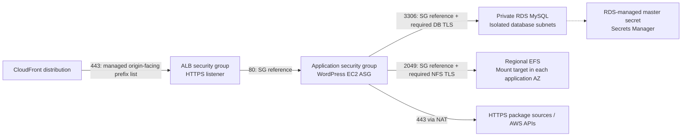
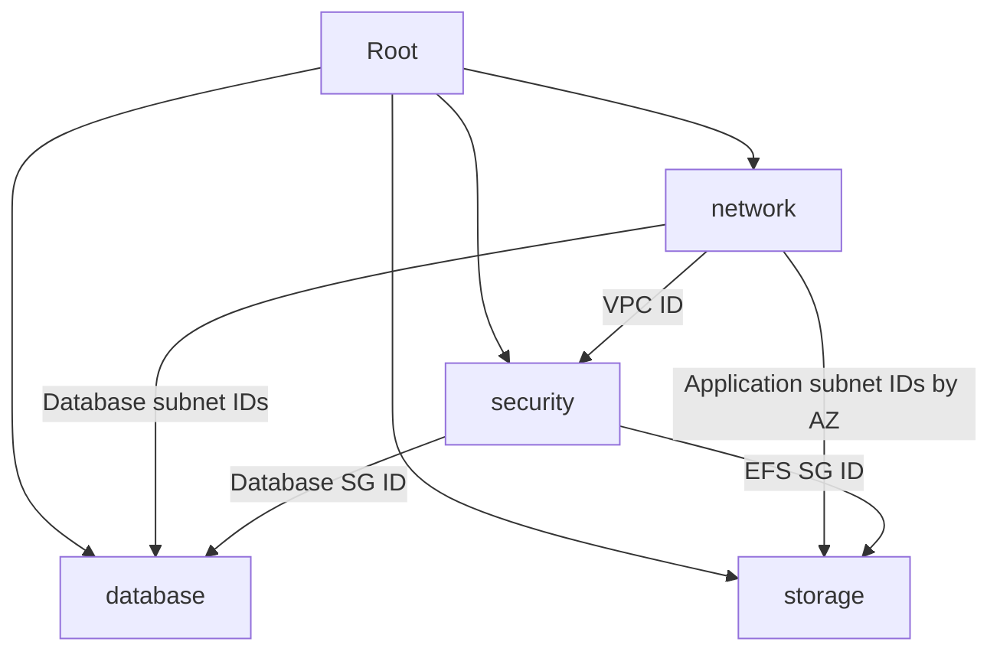

# Security groups and data services

Scope: network/data controls within the final integrated configuration. All nine modules are implemented and planned; no real resources have been provisioned. See the report for final frontend and verification results.

## Security boundaries

| Security group | Ingress | Initiated egress |
|---|---|---|
| ALB | TCP 443 from CloudFront origin-facing managed prefix list | TCP 80 to application SG |
| Application | TCP 80 from ALB SG | TCP 3306 to database SG; TCP 2049 to EFS SG; TCP 443 to IPv4 destinations through NAT |
| Database | TCP 3306 from application SG | None |
| EFS | TCP 2049 from application SG | None |

Security groups are stateful, so RDS and EFS replies do not require initiated-egress rules. SSH, public MySQL, public NFS and arbitrary application ingress are not enabled. The application HTTPS egress CIDR is broad because package sources and AWS APIs have changing destinations; this is a documented bootstrap trade-off. VPC resolver DNS does not require a security-group rule.

CloudFront's managed prefix list also includes other customers' distributions. A distribution-specific origin header check must be added to the future ALB listener. The prefix list consumes security-group quota according to its AWS-defined weight; check the account quota if additional ALB ingress rules are introduced.

## RDS configuration

The selected creation version is MySQL `8.4.11`, with parameter family `mysql8.4`, class `db.t4g.micro`, gp3 storage starting at 20 GiB and storage autoscaling capped at 100 GiB. AWS CLI read-only calls confirmed that this engine/class/storage combination supports Multi-AZ in `ap-southeast-2` at implementation time. Recheck availability before a later deployment. Automatic minor upgrades are enabled, so AWS may advance the running patch version during maintenance.

The instance uses only the database subnet group and database security group. It is not publicly accessible. Multi-AZ is enabled by default; `db_multi_az = false` is available for a lab and removes the standby. Encryption at rest uses the AWS-managed RDS KMS key. `require_secure_transport = ON` rejects plaintext database connections. The future WordPress client must enable TLS, load the current RDS CA bundle, and verify the server certificate.

RDS creates database `wordpress` and master user `wpadmin`. `manage_master_user_password = true` delegates password generation and management to RDS/Secrets Manager. Terraform outputs only the secret ARN, never reads its secret value, and does not supply a database password.

The master account is for administration and initialization. The subsequent [compute checkpoint](compute.md) adds a separate Lambda initializer that creates the schema-scoped WordPress user and application secret. EC2 receives no master-secret permission. Automatic application credential rotation remains unimplemented.

Backups are retained for seven days. Backup and maintenance windows are specified in UTC. Error and slow-query logs are exported to explicitly created CloudWatch log groups with 30-day retention. CloudWatch encrypts these log groups at rest using its service-managed encryption; no customer-managed log KMS key is configured.

Deletion protection is enabled, a final snapshot is required, and automated backups are retained on deletion. Before an intentional teardown, set `db_deletion_protection = false` and apply that change, review a destroy plan, and choose a unique `db_final_snapshot_identifier`. A previously used snapshot name will cause deletion to fail. Retained snapshots, backups and log groups can continue to incur charges and require a separate retention decision.

## Shared WordPress files

EFS is a Regional encrypted filesystem with an application-subnet mount target in each AZ. Its access point exposes only `/wordpress`, creates the directory with mode `0755`, and maps client operations to non-root UID/GID `48`. The future Amazon Linux application bootstrap must use a matching web-service identity and mount it as `wp-content` using `amazon-efs-utils` with `tls,iam,accesspoint=<id>`.

The filesystem policy denies unencrypted NFS, use of a different or missing access point, and root access. It contains no public Allow statement. The subsequent compute checkpoint adds scoped `elasticfilesystem:ClientMount` and `elasticfilesystem:ClientWrite` permissions to the EC2 role, and makes compute wait for the storage module, including its mount targets and policy. Actual mounts and authorization denials remain untested until deployment.

Shared storage preserves uploads/plugins/themes across instance replacement. It does not itself coordinate initialization or upgrades. The compute checkpoint adds a shared initialization lock and disables live file updates through the WordPress UI; release updates still need a reviewed deployment procedure.

EFS automatic backups are enabled through its backup policy. The actual AWS Backup plan and retention must be reviewed in the account after deployment. Restore and application-consistency tests have not run.

Elastic throughput avoids sizing a fixed throughput allocation and incurs throughput-related charges in addition to stored data. RDS Multi-AZ, RDS storage/backups, Secrets Manager, CloudWatch logs, EFS and EFS backups add costs if applied. No price estimate has been claimed.

For observability, inspect RDS error/slow-query logs and CloudWatch database/EFS metrics after deployment. Configure a durable encrypted CloudTrail destination for control-plane and supported EFS client-authorization events, plus application access logs when compute is added. CloudTrail does not provide a full NFS file-operation audit log; assess OS/application logging separately if that is required. An account-wide trail is not provisioned here.

## Modules and contracts

| Module | Inputs | Outputs |
|---|---|---|
| `security` | `name`, `vpc_id` | `security_group_ids`: IDs keyed by `alb`, `application`, `database`, `efs` |
| `database` | `name`, two `subnet_ids`, `security_group_id`, `engine_version`, `instance_class`, `multi_az`, `deletion_protection`, `final_snapshot_identifier` | `connection`: address, port, database name, managed master secret ARN |
| `storage` | `name`, `subnet_ids` map keyed by AZ, `security_group_id` | `file_system`: ID/ARN/DNS and access-point ID/ARN; `mount_target_ids` map by AZ |

The root exposes `database` and `shared_content` metadata. All modules inherit the root AWS provider and default tags.

## References

- [RDS: requiring TLS for MySQL](https://docs.aws.amazon.com/AmazonRDS/latest/UserGuide/mysql-ssl-connections.require-ssl.html)
- [Terraform: RDS instance configuration](https://registry.terraform.io/providers/hashicorp/aws/latest/docs/resources/db_instance)
- [EFS: IAM client authorization, TLS and access point conditions](https://docs.aws.amazon.com/efs/latest/ug/iam-access-control-nfs-efs.html)
- [EFS: security considerations](https://docs.aws.amazon.com/efs/latest/ug/security-considerations.html)
