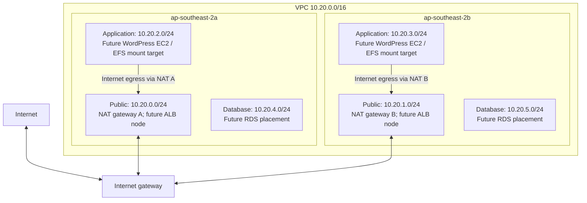

# Network design

Status: implemented and planned against AWS on 2026-10-31. Not deployed.

The region is `ap-southeast-2`. The root configuration selects the first two sorted, available standard AZ names returned for the account. The current plan selected `ap-southeast-2a` and `ap-southeast-2b`. These names are account-specific. Keep the AZ selection stable when maintaining deployed environments; changing the selected zones can replace subnets.

ALB, EC2, EFS and RDS labels describe workload placement in the completed configuration; none are deployed. See [data services](data-services.md), [compute](compute.md) and [frontend](frontend.md). The database route table contains only the automatic VPC-local route, with no internet/NAT default. Public-IP auto-assignment is disabled; public subnets use an internet-gateway route. The ALB is explicitly internet-facing and NAT gateways have Elastic IPs.

## Routing and availability

| Tier | Subnets | Default route | Intended workload |
|---|---|---|---|
| Public | Two /24 networks | Internet gateway | ALB and zonal NAT gateways |
| Application | Two /24 networks | NAT in the same AZ by default | WordPress instances and EFS mount targets |
| Database | Two /24 networks | None | RDS subnet group |

`single_nat_gateway = false` is the default. It provisions two NAT gateways and avoids making the other AZ's NAT the egress dependency. Setting it to `true` creates one NAT gateway in the first AZ and routes both application subnets through it. This lab option reduces the number of NAT gateways while introducing a shared failure dependency and possible cross-AZ data transfer. No cost estimate has been made.

## NACL traffic and return paths

All rules are IPv4 TCP allow rules. Unmatched traffic is denied by the custom NACL. Each of the six subnets has an explicit NACL association and route-table association.

| NACL | Direction | Peer CIDR | Destination ports | Purpose |
|---|---|---|---|---|
| Public | Inbound | Any IPv4 | 443 | Future CloudFront-to-ALB HTTPS and application-to-NAT HTTPS |
| Public | Inbound | Any IPv4 | 1024-65535 | Replies to NAT connections and replies from ALB targets |
| Public | Outbound | Any IPv4 | 443 | NAT-to-HTTPS destinations |
| Public | Outbound | Any IPv4 | 1024-65535 | Replies to ALB clients and NAT clients |
| Public | Outbound | Application subnet CIDRs | 80 | Future ALB application and health-check requests |
| Application | Inbound | Public subnet CIDRs | 80 | Future ALB requests |
| Application | Inbound | Any IPv4 | 1024-65535 | Replies from HTTPS services, RDS and EFS |
| Application | Inbound/outbound | Application subnet CIDRs | 2049 | Future EFS mount traffic |
| Application | Outbound | Any IPv4 | 443 | HTTPS bootstrap and AWS APIs through NAT |
| Application | Outbound | VPC CIDR | 1024-65535 | Replies to ALB and EFS clients |
| Application | Outbound | Database subnet CIDRs | 3306 | Future MySQL connections |
| Database | Inbound | Application subnet CIDRs | 3306 | Future MySQL connections |
| Database | Outbound | Application subnet CIDRs | 1024-65535 | MySQL replies |

The broad ephemeral-port rules overlap some named ports (including 2049 and 3306). NACLs cannot distinguish an established reply from a new connection. Workload security groups therefore enforce the final ALB/EC2/EFS/RDS boundaries; see the subsequent [data-services design](data-services.md). Public HTTPS ingress at the NACL layer is also intentionally broad because NAT shares those subnets. The ALB security group restricts inbound HTTPS to CloudFront origin-facing ranges; an additional listener check to restrict the distribution is pending.

Amazon-provided VPC DNS resolver traffic cannot be blocked by NACLs, so no misleading resolver rules are added. Bootstrap is designed for HTTPS; HTTP package sources would require a reviewed rule change. IPv6 is not configured.

The default security group has no ingress or egress rules. Dedicated workload security groups are implemented in the subsequent security/data-services checkpoint.

## Module inputs and outputs

Root calls `modules/network` directly. The child module inherits the root AWS provider and its default tags.

| Input | Type | Default / source | Purpose |
|---|---|---|---|
| `name` | string | Root sets `xtremax-wordpress` | Resource name prefix |
| `vpc_cidr` | string | `10.20.0.0/16` | /16 split into six /24 networks |
| `availability_zones` | list(string) | Root AWS AZ data source | Exactly two distinct AZs |
| `single_nat_gateway` | bool | `false` | Optional lab egress topology |

| Output | Shape | Consumer |
|---|---|---|
| `vpc_id` | string | Future workload security groups |
| `subnets` | map of tier to AZ to `{ id, cidr }` | Future ALB, ASG, RDS and EFS modules |
| `nat_gateway_ids` | map of AZ to NAT ID | Operational inspection |

## References

- [AWS: custom network ACLs and ephemeral ports](https://docs.aws.amazon.com/vpc/latest/userguide/custom-network-acl.html)
- [AWS: NAT gateway basics](https://docs.aws.amazon.com/vpc/latest/userguide/nat-gateway-basics.html)
- [HashiCorp: subnet resource](https://registry.terraform.io/providers/hashicorp/aws/latest/docs/resources/subnet)
- [HashiCorp: route table resource](https://registry.terraform.io/providers/hashicorp/aws/latest/docs/resources/route_table)
