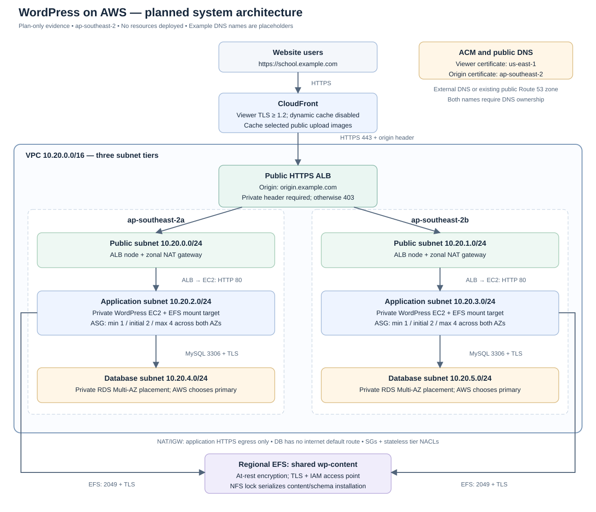
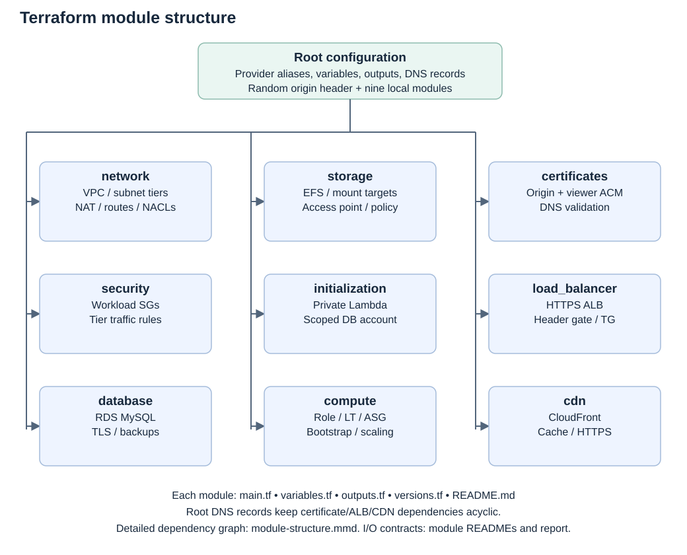

# Xtremax Cloud Engineer Technical Test

## Technical implementation report

Prepared: 1 November 2026 (Asia/Bangkok). Region: **ap-southeast-2**. Submission mode: **Terraform plan only; no deployment**.

### 1. Executive summary

This submission defines a WordPress school website on AWS using Terraform. The request path is CloudFront → HTTPS Application Load Balancer → WordPress EC2 Auto Scaling Group → private RDS MySQL. Regional EFS shares WordPress content across instances. Dedicated security groups, custom subnet NACLs, restricted IAM roles, runtime secret retrieval, encrypted storage and scaling alarms are included.

The complete configuration passed Terraform initialization/validation and a real AWS-backed plan proposing **108 additions, 0 changes and 0 deletions**. Fourteen Terraform mocked runs and four Python unit tests passed. Shell/PHP syntax, PHP MySQL TLS flags, rendered user-data size, source/artifact consistency and full-plan configuration checks were also verified. These checks establish configuration evidence, not deployed application behavior.

**Environment limitation:** no owned domain or public DNS zone is available. `school.example.com`, `origin.example.com` and `admin@example.com` are explicitly disclosed planning examples. No ACM certificate has been issued, no DNS resolution or HTTPS handshake has been validated, and no WordPress/scaling runtime result is claimed. Before a deployment, the applicant must supply owned names, complete DNS validation and run the runtime test plan. The original test permits a Terraform plan instead of provisioning real resources; this report uses that route and discloses its limits.

### 2. Requirements and assumptions

The original four-page technical-test PDF is the source of requirements. The supplied development plan is implementation guidance. EFS, Secrets Manager, NAT, SSM, desired capacity 2 and the initializer Lambda are design choices supporting correctness and secure automation; the PDF does not prescribe these services individually. Sydney (`ap-southeast-2`) replaces the development plan's tentative Singapore region at the applicant's direction.

| ID | Requirement | Implementation and evidence |
|---|---|---|
| R01 | Terraform provisioning | Root plus nine local modules; locked providers; full real plan and validation evidence |
| R02 | CloudFront CDN | HTTPS custom-domain distribution; dynamic cache disabled; narrow public-image behaviors |
| R03 | ALB traffic distribution | Public two-AZ ALB, HTTPS listener, origin-header rule, instance target group and ASG attachment |
| R04 | WordPress on EC2 ASG | Pinned Amazon-owned base AMI plus automated WordPress bootstrap, shared content and readiness endpoint |
| R05 | ASG min 1 / max 4 | Hardcoded bounds, initial desired 2, mock assertions and full plan |
| R06 | CPU >80% for 30 minutes scales out | Strict GreaterThanThreshold, 6/6 × 300s, +1 step policy |
| R07 | CPU <40% for 30 minutes scales in | Strict LessThanThreshold, 6/6 × 300s, -1 step policy |
| R08 | Secure RDS MySQL | Private Multi-AZ MySQL, isolated subnets, encryption, backups and required TLS |
| R09 | HTTPS at CloudFront and ALB | Separate validated ACM dependencies in correct regions; issuance/runtime pending owned DNS |
| R10 | SG and NACL restrictions | SG-to-SG tier boundaries and stateless NACL return paths |
| R11 | Minimum required IAM | Separate initializer/application roles; EC2 has no master-secret access; scoped EFS/secret rights |
| R12 | Architecture/security documentation | This report, focused design documents and security review |
| R13 | Test plan/results | Mapped configuration/runtime cases; actual PASS evidence and explicit NOT RUN results |
| R14 | System/module diagrams and I/O | Standalone SVG/Mermaid diagrams; module contracts below and per-module READMEs |
| R15 | Terraform ZIP and one email | Source bundle and report prepared locally; email draft provided; applicant sends all deliverables together |

“WordPress image” is interpreted as a pinned AL2023 image bootstrapped into WordPress, rather than a separately pre-baked marketplace/custom WordPress AMI. The PDF describes both two-tier and three-tier architecture; the implementation separates public ingress, private application and isolated database subnets. The receipt date/deadline was not confirmed in this session; the applicant must confirm the four-day submission window from the recruiter's actual receipt date.

### 3. System architecture

CloudFront receives public requests and redirects HTTP to HTTPS. Its custom origin is an owned DNS name pointing to the ALB, matching the regional certificate. The ALB distributes requests to EC2 targets over private HTTP/80. EC2 connects to RDS using TLS and mounts EFS with TLS/IAM through an access point. Application instances have no public IP and use a zonal NAT gateway for HTTPS package/API access. Database subnets have only a VPC-local route, with no internet or NAT default route.

The VPC is `10.20.0.0/16`. Current account AZ selection is `ap-southeast-2a` and `ap-southeast-2b`; public subnets are `10.20.0.0/24` and `10.20.1.0/24`, application subnets `10.20.2.0/24` and `10.20.3.0/24`, database subnets `10.20.4.0/24` and `10.20.5.0/24`. AZ names are account-specific. Pin/review AZ placement before maintaining an existing deployed environment; a changed sorted AZ selection can replace subnets.

### 4. Terraform module structure and root files

The dependency order is network/security → database/storage → initialization → compute, with certificates → ALB → origin DNS → CloudFront → site DNS. The ALB target-group output also feeds compute. DNS endpoint records are root resources, separate from certificate validation, preventing a module-level circular dependency. `docs/module-structure.mmd` contains the detailed dependency graph.

| Root file | Responsibility |
|---|---|
| main.tf | Compose modules, generate private origin header, create conditional DNS endpoint records |
| providers.tf | AWS application-region provider and us-east-1 alias; profile/account allowlist; default tags |
| versions.tf | Terraform/provider constraints |
| variables.tf | Region/profile/account, network, database, compute, site/origin and DNS inputs |
| outputs.tf | Non-secret infrastructure metadata and public ACM validation records |
| terraform.tfvars.example | Clearly marked sample values; real tfvars are excluded from the submission |
| .terraform.lock.hcl | Exact selected provider packages/checksums |
| scripts/ and assets/ | Verified initializer build, evidence/diagram/report generation, download lock manifest and packaging |

### 5. Module inputs and outputs

Every module has `main.tf`, `variables.tf`, `outputs.tf`, `versions.tf` and a README describing each input/output. Modules inherit root provider configuration and tags; certificates additionally receive the us-east-1 alias.

| Module | Purpose and inputs | Outputs |
|---|---|---|
| network | VPC/subnets/routes/NAT/NACLs. Inputs: name, vpc_cidr, availability_zones, single_nat_gateway | vpc_id; subnets by tier/AZ with ID/CIDR; nat_gateway_ids |
| security | Dedicated tier SGs and CloudFront prefix-list lookup. Inputs: name, vpc_id | security_group_ids keyed alb/application/database/efs |
| database | Private MySQL, TLS parameters, retained logs/backups. Inputs: name, subnet_ids, security_group_id, engine_version, instance_class, multi_az, deletion_protection, final_snapshot_identifier | connection: address, port, database_name, master_secret_arn |
| storage | Encrypted EFS, backup policy, mount targets and restricted access point. Inputs: name, subnet_ids by AZ, security_group_id | file_system ID/ARN/DNS and access-point ID/ARN; mount_target_ids |
| initialization | Private one-time administrative setup. Inputs: name, subnet_ids, security_group_id, db_address, master_secret_arn, package_file | application_secret_arn; readiness result |
| compute | Role/profile, launch template, ASG, bootstrap and scaling. Inputs: name, ami_id, instance_type, subnet_ids, security_group_id, application_secret_arn, db_address, efs metadata, downloads, site_url, admin_email, desired_capacity, target_group_arns | autoscaling_group_name; instance_role_arn; launch_template_id |
| certificates | Origin/viewer requests and validation, optional Route 53 CNAMEs. Inputs: name, site_domain_name, origin_domain_name, hosted_zone_id | validated origin_certificate_arn and viewer_certificate_arn; dns_validation_records; managed_validation_record_count |
| load_balancer | HTTPS ALB, target group and default-deny origin gate. Inputs: name, vpc_id, subnet_ids, security_group_id, certificate_arn, sensitive origin_header_value | target_group_arn; dns_name; zone_id |
| cdn | HTTPS edge delivery, dynamic/static cache and response headers. Inputs: name, site_domain_name, origin_domain_name, viewer_certificate_arn, sensitive origin_header_value | distribution ID, domain_name and hosted_zone_id |

### 6. Provisioning and application configuration

Prerequisites are Terraform (tested 1.17.1), Python 3.10+ (tested locally on Python 3.13), AWS CLI/profile access, sufficient IAM/read/provisioning permissions, owned public DNS names for a real deployment, and an approved budget. Locked providers are AWS 6.71.0 and random 3.9.1. The observed local profile is `xtremax`; no account credentials are included. The account-ID allowlist prevents using the wrong account.

On a fresh source checkout, create real `terraform.tfvars` from the example and replace the account ID. Build `artifacts/db-initializer.zip` using `python scripts/prepare-artifacts.py` if the supplied artifact is absent or the source changes. Then run init, fmt check, validate, tests and an untargeted plan. Keep saved binary plans/state and raw plan JSON private. The included sanitized text and configuration hashes describe the reviewed plan.

For Route 53, supply an existing public zone covering both site and origin names. Terraform manages both validation CNAMEs and endpoint aliases. For external DNS, leave hosted_zone_id null, request the two certificates first, publish their validation CNAMEs, wait for issuance, then review a full plan. Publish the origin CNAME to the ALB and site CNAME to CloudFront when their targets exist. Detailed staged commands are in `docs/frontend.md`. Placeholder names must never be treated as issued certificates or working endpoints.

The pinned base AMI is `ami-062900c135ab91582`, Amazon-owned AL2023 x86_64 in Sydney. Read-only AWS lookups verified the image and t3.small architecture. The image ID must be reselected for another region or when retired. WordPress 7.1.4 and PyMySQL 1.1.2 are pinned, and downloads/CA bytes are checked against `assets/downloads.json`. PHP 8.3 packages come from the pinned AL2023 image's repository release; installation on EC2 has not run here.

The initializer Lambda has a dedicated administrative role and no public trigger. During a real apply, Terraform invokes it after RDS and network readiness. It reads the RDS-managed master secret, takes a MySQL named lock, generates/reuses the application secret, and creates the fixed WordPress user with SSL required and privileges limited to `wordpress.*`. Persisting the password before SQL allows a retry to reuse credentials; taking the lock before secret generation avoids concurrent password races. Terraform receives only a readiness result. Destroy does not invoke the function.

EC2 receives only application-secret and scoped EFS permissions. A retrying systemd service installs Apache/PHP/EFS tools, verifies download checksums, mounts shared content with tls/iam/accesspoint, retrieves the secret at runtime, and stores it outside the document root with root/Apache-only access. An EFS lock serializes content seeding and WordPress schema initialization. Shared salts prevent cross-instance login inconsistency. Core/UI file updates are disabled; maintenance is a reviewed deployment operation. The readiness script checks installed schema, shared-content initialization and a database query.

### 7. Network, IAM and secret security

| Source | Destination | Port / purpose |
|---|---|---|
| Public users | CloudFront | HTTPS 443 |
| CloudFront origin-facing prefix list | ALB | HTTPS 443; additional private header required |
| ALB SG | Application SG | HTTP 80 and application health check |
| Application SG | Database SG | MySQL 3306, TLS required |
| Application SG | EFS SG | NFS 2049 with mount-helper TLS/IAM |
| Application subnet via NAT | HTTPS package/API destinations | TCP 443 |

NACLs are stateless and include explicit ephemeral return ports 1024–65535. Public NAT/ALB subnets need broader HTTPS and return-port rules; application return traffic also requires broad ephemeral ingress. These ranges overlap high service ports, so identity-based SG boundaries remain essential. Database NACL ingress permits MySQL only from application CIDRs, with replies to application ephemeral ports. Amazon-provided resolver traffic cannot be filtered using these NACLs. The default SG is empty; IPv6 is not enabled inside the VPC even though CloudFront can accept IPv6 viewers.

Storage is encrypted at rest (EBS, RDS, EFS). CloudFront/viewer and CloudFront/ALB are HTTPS; RDS and EFS client encryption is configured. The ALB-to-EC2 HTTP hop is an explicit private-network trade-off, so the report does not claim end-to-end transport encryption. Runtime certificate/mount enforcement is untested.

IAM separates provisioning-time database administration from steady-state EC2 access. EC2 cannot read the master secret or write secrets and can mount/write only the designated filesystem/access point over TLS. SSM channel/registration actions use narrowly selected actions with Resource * where usable resource scoping is unavailable. Lambda ENI actions also require Resource *; a source-function condition denies code-level use while preserving Lambda service operations. No static access keys or passwords appear in user data or Terraform variables.

The generated origin-header value is sensitive, is not an output, and will exist in private state/plan after a real apply. Local state is used for the assessment; production state should use restricted encrypted remote storage and locking. Protect backups of state as well. Application-secret rotation and fleet refresh are not automated; RDS independently manages its master password. CDN/ALB access logs, Session Manager content logging, account-wide CloudTrail and production alert routing are not provisioned. See `docs/security-review.md` for controls and accepted limitations, including optional WAF/Shield/CSP hardening.

### 8. Scaling behavior

The ASG minimum is 1, maximum 4 and initial desired size 2 across private subnets. Six breaching five-minute ASG-average CPU periods trigger a +1 step above 80% or a -1 step below 40%. Comparison operators are strict; equality does not breach. Missing data is notBreaching. The 30-minute condition comes from period/evaluation/datapoint settings, independently of the 600-second instance warmup. Metric aggregation and CloudWatch interval/missing-sample evaluation mean this is not a per-second continuity or exact launch-time guarantee.

Terraform ignores desired-capacity drift after creation so it does not undo dynamic scaling. Numeric launch-template versions and rolling refresh are configured. The ASG now uses ELB health checks, a 900-second grace period, and the ALB instance target group; unhealthy application targets can therefore cause replacement. Refresh rounding/fallback for very small groups and bootstrap timing require runtime review. Because minimum capacity is one, application multi-instance availability is not guaranteed throughout all scaling states.

t3.small uses explicit unlimited CPU credits so fresh instances can sustain the specified load condition. Surplus CPU credit charges are possible. Real scaling tests must retain the complete 30-minute metric window and activity history; a forced alarm state or shortened threshold is not equivalent.

### 9. Test evidence and results

| Check | Actual result | Evidence / limits |
|---|---|---|
| Init, fmt and validate | PASS | Locked providers initialized; current configuration valid |
| Real full plan | PASS: 108 add, 0 change, 0 destroy | evidence/terraform-plan.txt; example DNS caveat retained |
| Derived full-plan checks | PASS: 9 checks | Private RDS, ASG/ALB wiring, certificate provider/name matching, cache/TLS checks in plan-summary.json |
| Terraform mocked suite | PASS: 14 runs | Network variants, security/data, initializer, compute/scaling, ALB/CDN and both DNS certificate modes |
| Python initializer suite | PASS: 4 cases | Fake clients verify lock ordering, credential reuse, failed lock and interrupted SQL cleanup |
| Shell/PHP and payload checks | PASS | Shell syntax, three PHP files, TLS flag availability; mocked rendered payload 5588 compressed bytes |
| Extracted source bundle | PASS: manifest/source hashes, init, validate and 14 mocked runs | evidence/reproduction-checks.txt; no live deployment |
| WordPress, TLS, mounts, replacement, backups and 30-minute scaling | NOT RUN | No deployment or owned DNS; runtime cases documented |

The mocked provider never calls AWS, even when a test run uses command=apply. The real plan makes provider/data-source reads but does not create resources or invoke the initializer. Some reads are deferred until apply due to module readiness dependencies; a successful plan does not prove future create APIs, service-linked roles, quotas, DNS issuance or connectivity will succeed. This separation is reflected in `docs/test-plan.md` and `docs/test-results.md`.

### 10. Availability, cost and cleanup

Two AZs, zonal NAT, RDS Multi-AZ and Regional EFS reduce single-AZ dependencies. Desired capacity 2 helps application availability initially, but minimum 1 permits a single application instance. No cross-region disaster-recovery architecture or measured RTO/RPO is claimed. RDS/EFS restore behavior has not been tested.

The principal cost drivers are EC2/EBS and possible T3 surplus credits; RDS Multi-AZ/storage/backups; two NAT gateways, public IPv4 and NAT data; ALB capacity/usage; CloudFront requests/transfer; EFS storage/elastic throughput/backups; Secrets Manager; logs/metrics; and occasional initializer execution. The lab switches single_nat_gateway=true and db_multi_az=false reduce resources while introducing explicit availability trade-offs. No unverified monthly price is quoted; calculate a deployment budget using actual region, workload, retention and duration before applying.

For an intentional teardown, preserve required content/backups first. Review a fresh plan disabling DB deletion protection, apply only the intended protection change, then review the destroy plan. Use a unique final snapshot name. CloudFront propagation and Lambda ENI cleanup can take time. Inspect retained RDS snapshots/automated backups, AWS Backup recovery points, any intentionally retained logs and scheduled secret deletions; do not assume destroying the main stack removes all retained data or future charges. No resources were created during this session, so no teardown was executed.

### 11. Reproducibility and submission

The source ZIP includes Terraform root/modules, provider lock file, bootstrap/initializer source, a verified non-secret initializer ZIP, download manifest, tests, documentation, standalone SVG/Mermaid diagrams and sanitized evidence. It excludes real tfvars, credentials, .terraform, .tools, .git, private data, state and binary saved plans. An internal SHA256 manifest allows file-integrity checks. The extracted bundle is checked with the installed verified providers and mocked tests, without cloud provisioning.

Send the ZIP and this report together in one email, as required by the PDF. An English email draft is included for the applicant to review and send. No email has been sent by this automation. The remaining environmental prerequisite is owned DNS and a fresh reviewed plan before any optional deployment; runtime tests remain explicitly NOT RUN.

### 12. References

- Original requirements: `Cloud_Engineer_-_Technical_Test_-_Xtremax.pdf`, supplied separately by the applicant.
- [AWS CloudFront certificate requirements](https://docs.aws.amazon.com/AmazonCloudFront/latest/DeveloperGuide/cnames-and-https-requirements.html)
- [AWS ALB origin restriction guidance](https://docs.aws.amazon.com/AmazonCloudFront/latest/DeveloperGuide/restrict-access-to-load-balancer.html)
- [AWS CloudWatch alarm evaluation](https://docs.aws.amazon.com/AmazonCloudWatch/latest/monitoring/AlarmThatSendsEmail.html#alarm-evaluation)
- [AWS EC2 step scaling](https://docs.aws.amazon.com/autoscaling/ec2/userguide/as-scaling-simple-step.html)
- [AWS RDS MySQL TLS enforcement](https://docs.aws.amazon.com/AmazonRDS/latest/UserGuide/mysql-ssl-connections.require-ssl.html)
- [AWS EFS IAM authorization](https://docs.aws.amazon.com/efs/latest/ug/iam-access-control-nfs-efs.html)
- [AWS Lambda VPC permissions](https://docs.aws.amazon.com/lambda/latest/dg/configuration-vpc.html)
- [WordPress release archive](https://wordpress.org/download/releases/)
